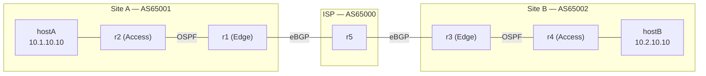

# Multi-Site Network Automation Lab

[](https://github.com/Eng-Abdulaziz-Asiri/network-automation-lab/actions/workflows/ci.yml)


A reproducible enterprise network lab — **two branch sites connected through an ISP** — built entirely as code.
One YAML file describes the whole network; **Ansible** renders and pushes the configs; a **Python health check** verifies it live.
Spin up 5 routers + 2 hosts, configure OSPF, BGP & BFD, and validate end-to-end connectivity with **one command**: `make all`.

---

## Topology



| Link | Subnet | Protocol |
|---|---|---|
| r1 ↔ r2 | 10.1.0.0/30 | OSPF area 0 (point-to-point) + BFD |
| r2 ↔ hostA | 10.1.10.0/24 | OSPF (passive) |
| r1 ↔ r5 | 100.64.1.0/30 | eBGP 65001 ↔ 65000 + BFD |
| r5 ↔ r3 | 100.64.2.0/30 | eBGP 65000 ↔ 65002 + BFD |
| r3 ↔ r4 | 10.2.0.0/30 | OSPF area 0 (point-to-point) + BFD |
| r4 ↔ hostB | 10.2.10.0/24 | OSPF (passive) |

**Routing design:** each site runs OSPF internally. Edge routers advertise a site aggregate (`10.1.0.0/16`, `10.2.0.0/16`) to the ISP over eBGP and redistribute BGP routes back into OSPF. Every routed link is protected by **BFD** (200 ms × 3), so a failure is detected in under a second.

---

## Features

- **Infrastructure as Code** — topology, data, and configs all live in Git
- **Single Source of Truth** — `ansible/group_vars/all.yml` defines every IP, ASN, and neighbor
- **Templated configs** — one Jinja2 template generates `frr.conf` for all routers
- **Idempotent automation** — Ansible only reloads routers whose config actually changed
- **Live health check** — compares *expected* (from the data file) vs *actual* (from the routers) and prints PASS/FAIL
- **One-command workflow** — `make all` builds, configures, waits, and tests
- **Automated config backups** — `make backup` saves every router's running config to `backups/` with a timestamp
- **Config drift detection** — `make drift` compares each router's running config with the Source of Truth and shows any manual change
- **Fast failure detection (BFD)** — every OSPF and eBGP link runs BFD; `make failover` breaks a link *silently* and proves it is detected in < 1 s instead of the 180 s BGP hold timer
- **CI pipeline** — every push deploys the full lab on GitHub Actions and runs the health check, drift check and BFD failover test

---

## Quick Start

Choose **one** way to run the lab:

### Option A — In your browser (no install)

[](https://codespaces.new/Eng-Abdulaziz-Asiri/network-automation-lab?quickstart=1)

1. Click the button above and choose **Create codespace** (free GitHub account required)
2. Wait ~3–5 minutes for the environment to build
3. In the terminal, run:
```bash
make all
```
> When you're done, stop the codespace from [github.com/codespaces](https://github.com/codespaces) to save your free hours.

### Option B — On your own machine

**Requirements:** Linux or Windows with WSL2 (Ubuntu), [Docker](https://docs.docker.com/engine/install/), [Containerlab](https://containerlab.dev/install/), and `sudo apt install -y git ansible make`

```bash
git clone https://github.com/Eng-Abdulaziz-Asiri/network-automation-lab.git
cd network-automation-lab
make all
```
> Stuck? See [Troubleshooting](#troubleshooting).

### Commands
| Command | What it does |
|---|---|
| `make all` | Deploy → configure → wait → test |
| `make deploy` | Start routers and links |
| `make configure` | Push configs with Ansible |
| `make test` | Run the health summary |
| `make backup` | Save running configs to `backups/` |
| `make drift` | Check routers for config drift |
| `make failover` | Silent link failure test — how fast BFD detects it |
| `make destroy` | Tear down the lab |

---

## Health Check

`make test` shows every device with its role, ASN, and live OSPF/BGP/BFD status, then pings hostA → hostB:

```
Lab: netauto  |  Nodes: 7 (5 routers, 2 hosts)  |  Links: 6

Router Role    Loopback       ASN    Ifaces OSPF   BGP    BFD    Routes  Status
r1     Edge    10.1.255.1     65001  2      1/1    1/1    2/2    12      PASS
r2     Access  10.1.255.2     -      2      1/1    0/0    1/1    10      PASS
r3     Edge    10.2.255.3     65002  2      1/1    1/1    2/2    12      PASS
r4     Access  10.2.255.4     -      2      1/1    0/0    1/1    10      PASS
r5     ISP     100.64.255.5   65000  2      0/0    2/2    2/2    10      PASS

End-to-end: hostA -> hostB (10.2.10.10)  PASS
Overall: HEALTHY
```

### Try breaking it
Simulate a link failure and watch the check catch it:
```bash
docker exec clab-netauto-r5 ip link set eth1 down
make test        # r1 / r5 -> FAIL, end-to-end -> FAIL
docker exec clab-netauto-r5 ip link set eth1 up
sleep 10 && make test   # back to HEALTHY
```

---

## BFD — Fast Failure Detection

**The problem:** not every failure takes the interface down. If a switch or fiber *in the middle* of a link breaks,
both routers still see their port as **UP** — so OSPF and BGP keep sending traffic into a black hole until their
own timers expire (**180 s** for the BGP hold timer here).

**The fix:** BFD sends tiny hello packets every 200 ms. If 3 in a row are missed (**600 ms**), BFD tells OSPF/BGP
to drop the neighbor immediately. It is defined once in the Source of Truth and turned on per link:

```yaml
bfd:
  profile: fast
  interval_ms: 200     # transmit + receive interval
  multiplier: 3        # detection time = 200 ms x 3 = 600 ms

interfaces:
  - { name: eth1, ip: 10.1.0.1/30, ospf: true, p2p: true, bfd: true }
neighbors:
  - { ip: 100.64.1.1, remote_as: 65000, desc: ISP, bfd: true }
```

### Prove it: `make failover`

The test drops every packet on the ISP side of the r1 ↔ r5 link (the link stays **UP**) and times how long
r1 takes to notice, then repairs the link and waits for BGP to come back:

```
BFD failover test  (r1 eth2 <-> r5 eth1, BGP peer 100.64.1.1)

  Breaking the link silently: dropping all packets on r5 eth1 ...
  Repairing the link, waiting for BGP to come back ...

  r1 interface eth2 during failure: UP  (silent failure)
  BFD timers:                    200 ms x 3
  Detected with BFD in:          0.62 s
  Without BFD (BGP hold timer):  180 s
  Recovered in:                  1.10 s

Result: PASS
```

> **~290× faster** failure detection. The same test runs in CI on every push and fails if detection takes more than 2 s.

---

## CI Pipeline

Every push to `main` runs [`.github/workflows/ci.yml`](.github/workflows/ci.yml) on GitHub Actions:

1. **Rendered configs are up to date** — `ansible-playbook --check` must report no changes
2. **Deploy + configure** the full lab (5 routers + 2 hosts)
3. **Health check** — OSPF, BGP, BFD and end-to-end ping must all PASS
4. **Drift check** — running configs must match the Source of Truth
5. **BFD failover test** — silent failure detected in < 2 s, then back to HEALTHY
6. **Backups** — running configs uploaded as a downloadable build artifact

---

## Project Structure

```
├── topology.clab.yml          # Lab topology (nodes + links)
├── Makefile                   # One-command workflow
├── ansible/
│   ├── group_vars/all.yml     # Source of Truth
│   ├── templates/frr.conf.j2  # Config template
│   ├── deploy.yml             # Playbook
│   ├── backup.yml             # Backup playbook
│   └── inventory.yml
├── configs/r1..r5/            # Rendered router configs (mounted into containers)
├── backups/                   # Timestamped config backups (git-ignored)
├── scripts/summary.py         # Live health check
├── scripts/drift.py           # Config drift detection
└── scripts/failover.py        # BFD silent-failure test
```

### Key files

| File | Purpose |
|---|---|
| [`ansible/group_vars/all.yml`](ansible/group_vars/all.yml) | Source of Truth: every IP, ASN and neighbor |
| [`ansible/templates/frr.conf.j2`](ansible/templates/frr.conf.j2) | Jinja2 template that renders each router's config |
| [`ansible/deploy.yml`](ansible/deploy.yml) | Playbook: render configs and reload FRR |
| [`ansible/backup.yml`](ansible/backup.yml) | Playbook: save each router's running config |
| [`scripts/summary.py`](scripts/summary.py) | Live health check (expected vs actual) |
| [`scripts/drift.py`](scripts/drift.py) | Drift check: intended config vs running config |
| [`scripts/failover.py`](scripts/failover.py) | BFD test: silent link failure, measures detection time |
| [`.github/workflows/ci.yml`](.github/workflows/ci.yml) | CI: deploy + test the whole lab on every push |
| [`topology.clab.yml`](topology.clab.yml) | Containerlab topology (nodes + links) |
| [`Makefile`](Makefile) | One-command workflow |

---

## Troubleshooting

For **Option B** (local setup):

| Problem | Fix |
|---|---|
| `permission denied ... docker.sock` | Add yourself to the groups, then restart the shell: `sudo usermod -aG docker,clab_admins $USER` |
| **WSL:** `which docker` shows `/mnt/c/Program Files/Docker/...` | Docker Desktop is leaking into WSL. Disable *Settings → Resources → WSL Integration* for Ubuntu, or add `appendWindowsPath=false` under `[interop]` in `/etc/wsl.conf` |
| **WSL:** Docker service won't start | Enable systemd: add `[boot]` / `systemd=true` to `/etc/wsl.conf`, then run `wsl --shutdown` from PowerShell |
| A node lost its links after `docker stop` / `docker start` | Containerlab links are removed when a container stops. Rebuild with `make deploy` |
| `make test` shows FAIL right after deploy | Protocols may still be converging. Wait ~20s and run `make test` again |
| BFD column shows `0/1` or `0/2` after `git pull` | `bfdd` only starts when the router boots. Rebuild with `make deploy`, then `make configure` |
| `make failover` asks for a password | It uses `sudo nsenter` + `iptables` to drop packets inside r5's network namespace. Enter your sudo password |

---

## Roadmap

- [x] CI pipeline with GitHub Actions (build + test on every push)
- [x] Config drift detection
- [x] Automated config backups
- [x] BFD for faster failure detection

---

## Author

**Abdulaziz Asiri** — Computer & Network Engineering student
[GitHub](https://github.com/Eng-Abdulaziz-Asiri)
