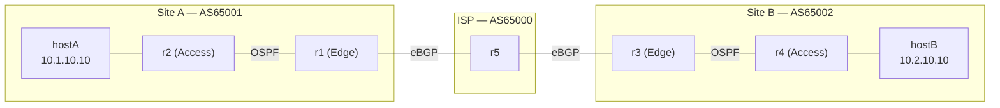

# Multi-Site Network Automation Lab


A reproducible enterprise network lab — **two branch sites connected through an ISP** — built entirely as code.
One YAML file describes the whole network; **Ansible** renders and pushes the configs; a **Python health check** verifies it live.
Spin up 5 routers + 2 hosts, configure OSPF & BGP, and validate end-to-end connectivity with **one command**: `make all`.

---

## Topology



| Link | Subnet | Protocol |
|---|---|---|
| r1 ↔ r2 | 10.1.0.0/30 | OSPF area 0 (point-to-point) |
| r2 ↔ hostA | 10.1.10.0/24 | OSPF (passive) |
| r1 ↔ r5 | 100.64.1.0/30 | eBGP 65001 ↔ 65000 |
| r5 ↔ r3 | 100.64.2.0/30 | eBGP 65000 ↔ 65002 |
| r3 ↔ r4 | 10.2.0.0/30 | OSPF area 0 (point-to-point) |
| r4 ↔ hostB | 10.2.10.0/24 | OSPF (passive) |

**Routing design:** each site runs OSPF internally. Edge routers advertise a site aggregate (`10.1.0.0/16`, `10.2.0.0/16`) to the ISP over eBGP and redistribute BGP routes back into OSPF.

---

## Features

- **Infrastructure as Code** — topology, data, and configs all live in Git
- **Single Source of Truth** — `ansible/group_vars/all.yml` defines every IP, ASN, and neighbor
- **Templated configs** — one Jinja2 template generates `frr.conf` for all routers
- **Idempotent automation** — Ansible only reloads routers whose config actually changed
- **Live health check** — compares *expected* (from the data file) vs *actual* (from the routers) and prints PASS/FAIL
- **One-command workflow** — `make all` builds, configures, waits, and tests

---

## Quick Start

Choose **one** way to run the lab:

### Option A — In your browser (no install)

[](https://codespaces.new/Eng-Abdulaziz-Asiri/network-automation-lab?quickstart=1)

1. Click the button above and choose **Create codespace** (free GitHub account required)
2. Wait ~3–5 minutes for the environment to build
3. In the terminal, run:
```bash
make all
```
> When you're done, stop the codespace from [github.com/codespaces](https://github.com/codespaces) to save your free hours.

### Option B — On your own machine

**Requirements:** Linux or Windows with WSL2 (Ubuntu), [Docker](https://docs.docker.com/engine/install/), [Containerlab](https://containerlab.dev/install/), and `sudo apt install -y git ansible make`

```bash
git clone https://github.com/Eng-Abdulaziz-Asiri/network-automation-lab.git
cd network-automation-lab
make all
```
> Stuck? See [Troubleshooting](#troubleshooting).

### Commands
| Command | What it does |
|---|---|
| `make all` | Deploy → configure → wait → test |
| `make deploy` | Start routers and links |
| `make configure` | Push configs with Ansible |
| `make test` | Run the health summary |
| `make destroy` | Tear down the lab |

---

## Health Check

`make test` shows every device with its role, ASN, and live OSPF/BGP status, then pings hostA → hostB:

```
Router Role    Loopback       ASN    Ifaces OSPF   BGP    Status
r1     Edge    10.1.255.1     65001  2      1/1    1/1    PASS
r2     Access  10.1.255.2     -      2      1/1    0/0    PASS
...
End-to-end: hostA -> hostB (10.2.10.10)  PASS
Overall: HEALTHY
```

### Try breaking it
Simulate a link failure and watch the check catch it:
```bash
docker exec clab-netauto-r5 ip link set eth1 down
make test        # r1 / r5 -> FAIL, end-to-end -> FAIL
docker exec clab-netauto-r5 ip link set eth1 up
sleep 10 && make test   # back to HEALTHY
```

---

## Project Structure

```
├── topology.clab.yml          # Lab topology (nodes + links)
├── Makefile                   # One-command workflow
├── ansible/
│   ├── group_vars/all.yml     # Source of Truth
│   ├── templates/frr.conf.j2  # Config template
│   ├── deploy.yml             # Playbook
│   └── inventory.yml
├── configs/r1..r5/            # Rendered router configs (mounted into containers)
└── scripts/summary.py         # Live health check
```

---

## Troubleshooting

For **Option B** (local setup):

| Problem | Fix |
|---|---|
| `permission denied ... docker.sock` | Add yourself to the groups, then restart the shell: `sudo usermod -aG docker,clab_admins $USER` |
| **WSL:** `which docker` shows `/mnt/c/Program Files/Docker/...` | Docker Desktop is leaking into WSL. Disable *Settings → Resources → WSL Integration* for Ubuntu, or add `appendWindowsPath=false` under `[interop]` in `/etc/wsl.conf` |
| **WSL:** Docker service won't start | Enable systemd: add `[boot]` / `systemd=true` to `/etc/wsl.conf`, then run `wsl --shutdown` from PowerShell |
| A node lost its links after `docker stop` / `docker start` | Containerlab links are removed when a container stops. Rebuild with `make deploy` |
| `make test` shows FAIL right after deploy | Protocols may still be converging. Wait ~20s and run `make test` again |

---

## Roadmap

- [ ] CI pipeline with GitHub Actions (build + test on every push)
- [ ] Config drift detection
- [ ] Automated config backups
- [ ] BFD for faster failure detection

---

## Author

**Abdulaziz Asiri** — Computer & Network Engineering student
[GitHub](https://github.com/Eng-Abdulaziz-Asiri)
